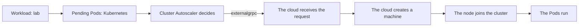

# Minikube Cloud Lab

A teaching lab for observing how Kubernetes requests capacity from a cloud provider.
The system separates three objects:

| Object | Responsibility | Tool |
| --- | --- | --- |
| Simulated cloud | Creates the cluster, owns machines, records requests | `cloud` |
| Kubernetes | Runs Pods and hosts Cluster Autoscaler | `kubectl` |
| Lab tools | Install Autoscaler and generate resource pressure | `lab` or YAML |

**Start with the [student tutorial](docs/student-tutorial.md)** for a guided experiment
with predictions, observations, checkpoints, and questions.



The MVP manages **one cluster at a time**, with a single machine type throughout.
The control plane counts toward the minimum and maximum size and is protected
from removal.

| Type | CPUs | Memory |
| --- | --- | --- |
| `lab-small` (default) | 2 | 2 GiB |
| `lab-medium` | 4 | 8 GiB |

Kubernetes is pinned to **v1.35.6**, Cluster Autoscaler to **v1.35.0**, and the
minikube library to **v1.39.0**. Nodes expose the standard instance-type label,
region `lab-region-1`, and zone `lab-region-1-a`.

Existing clusters keep their original machine resources. To adopt the smaller
`lab-small` shape, delete the old cluster through `cloud`, pull the updated
images, and create a new cluster. The configuration helper does not resize or
delete machines.

## Student quick start: Docker on Linux or macOS

You need Docker Engine on Linux or Docker Desktop on macOS, Compose v2, access
to the local Docker socket, and `kubectl` v1.35 to inspect the cluster.
The `cloud` and `lab` tools run in containers on both platforms; no Go install
or native project binaries are needed. For the default experiment, provide
at least 6 CPUs and 6 GiB of available memory. The images support Linux amd64
and arm64. Docker Desktop host networking is not required: Compose creates a
dedicated bridge network and publishes the management API on localhost.

The repository and GHCR images are public. Cloning over HTTPS and pulling the
images require no GitHub account, SSH key, or Docker login to `ghcr.io`.
Alternatively, build the images from a checkout as described below.

```sh
git clone https://github.com/miciav/minikube-cloud-lab.git ~/cloud-lab
cd ~/cloud-lab
source scripts/configure.sh
docker compose --profile tools pull
docker compose up -d cloud
docker compose ps

cloud machine-types list
cloud clusters create demo --machine-type lab-small --min-nodes 1 --max-nodes 3
cloud clusters get-credentials demo
kubectl get nodes -L node.kubernetes.io/instance-type,topology.kubernetes.io/zone
```

`source scripts/configure.sh` prepares the data directories, adds missing
UID/GID/socket-group entries to `.env`, and defines the `cloud` and `lab` shell
commands plus `KUBECONFIG` for this Bash or zsh session. Existing `.env` values are
preserved. Run it in each terminal; it does not edit shell startup files, pull
images, start Docker services, or create cluster resources. Students run Compose
and all cloud/Kubernetes commands explicitly.

On macOS, start Docker Desktop first. The helper uses BSD `stat` and configures
the group of Docker Desktop's root-owned VM socket. On Linux it reads the local
socket group with GNU `stat`. Existing explicit `.env` values are preserved;
correct copied UID/GID values if they belong to another machine.

New cluster nodes use Google's `https://mirror.gcr.io` cache for public Docker Hub
images, including workers added by the autoscaler. If an image is not cached,
Docker falls back to Docker Hub and its rate limits still apply. The setting is
applied when nodes are created; delete and recreate an existing cluster to use it.
The Docker daemon on your computer is not configured by this project.

Wait until `cloud machine-types list` responds before creating the cluster.
The first start downloads node images and Kubernetes components and may take
several minutes. The kubeconfig embeds its certificates, preserves other
contexts, and selects `demo` as the current context. It is published atomically
with permissions `0600`; when `KUBECONFIG` lists multiple files, merged entries
are written to the selected file. With Compose, the CLI writes `/kube/config`,
which is the host's `~/.kube/config`.
The `lab` container shares the running cloud container's network namespace,
so it consumes no address from minikube's node range. It uses the cloud's private
kubeconfig from the read-only state mount. Finish running `lab` commands before
recreating the cloud container. Host `kubectl` uses the exported localhost API
endpoint; the two endpoints use the same cluster identity and embedded certificates.

New clusters automatically include the **YAKD Kubernetes dashboard**, using the
addon bundled with minikube. Wait for its Deployment, then read its automatic
localhost NodePort endpoint:

```sh
kubectl -n yakd-dashboard rollout status deployment/yakd-dashboard --timeout=5m
lab services
```

Open the `127.0.0.1:PORT` shown for `yakd-dashboard` on the computer running
Docker. No forwarding terminal is needed. On a remote VM, use an SSH tunnel
(`ssh -L PORT:127.0.0.1:PORT USER@VM`) with that port.
YAKD uses a cluster-admin service account: keep this local UI private. It requests
128 MiB and is capped at 256 MiB. Metrics-server is not installed, so live usage
metrics are unavailable. Existing clusters are not modified; recreate them to
obtain YAKD. An API error installing YAKD fails the create operation and leaves
the partial cluster available for inspection or deletion through `cloud`.

### Local NodePort and LoadBalancer services

Use ordinary Kubernetes Service commands; the cloud publishes supported Services
automatically, usually within two seconds while no capacity operation is running:

```sh
kubectl -n yakd-dashboard expose deployment yakd-dashboard --name=dashboard-node --type=NodePort --port=80 --target-port=8080
kubectl -n yakd-dashboard expose deployment yakd-dashboard --name=dashboard-lb-one --type=LoadBalancer --port=80 --target-port=8080
kubectl -n yakd-dashboard expose deployment yakd-dashboard --name=dashboard-lb-two --type=LoadBalancer --port=80 --target-port=8080
lab services
```

Copy a displayed endpoint into `curl http://127.0.0.1:PORT` or your browser.
Each NodePort uses the same port on localhost. Each LoadBalancer has its own
Docker IP and a free localhost port assigned by Docker, so two Services on port
80 work together. `kubectl get services -A` shows the private Docker IP as
`EXTERNAL-IP`; on macOS, use the localhost endpoint from `lab services`, rather
than trying to reach that IP directly. The IP and Service port work inside the
Docker bridge. Ports are bound only to `127.0.0.1`, never the LAN.

`lab services` reads the `minikube-cloud-lab.io/host-endpoints` JSON annotation
(`name`, `servicePort`, `nodePort`, `hostPort`) and
`minikube-cloud-lab.io/exposure-error`. Its Kubernetes equivalent is
`kubectl get services -A -o json`. A missing endpoint means publication is pending
or failed; inspect the ERROR column. A NodePort already in use on the computer
fails explicitly: free that port or change the Service's NodePort.

The first release supports TCP, including raw TLS and database connections,
with `externalTrafficPolicy: Cluster`. UDP/SCTP, `Local`, custom LoadBalancer
classes and `allocateLoadBalancerNodePorts: false` produce a visible error without
partial exposure. Changing type/ports can interrupt connections and change
LoadBalancer host ports; restarting the cloud preserves unchanged relays.
Each Service uses one small relay container from the cloud image. It has no
Docker socket or credentials and does not count as a cloud machine.

```sh
kubectl -n yakd-dashboard delete service dashboard-node dashboard-lb-one dashboard-lb-two
```

Deleting a Service removes its relay; deleting the cluster removes all its relays.
For optional temporary dashboard access, the standard
`kubectl -n yakd-dashboard port-forward --address 127.0.0.1 service/yakd-dashboard 8081:80`
still works. See the [student exercises](docs/student-tutorial.md#try-nodeport-and-loadbalancer).

Watch cloud requests in another terminal:

```sh
cd ~/cloud-lab
docker compose logs -f cloud
```

Install Autoscaler and create the workload:

```sh
lab install autoscaler
kubectl -n kube-system rollout status deployment/cluster-autoscaler --timeout=5m
lab load start
kubectl get pods -l app=lab-load -w
```

Each of the four Pods requests 600m CPU, so a single `lab-small` machine cannot
host them all. In observation terminals, follow each link in the chain:

```sh
kubectl get nodes -w
kubectl -n kube-system logs -f deployment/cluster-autoscaler
cloud machines list
cloud operations list
```

Once two nodes are Ready and all four Pods are running, remove the workload:

```sh
kubectl rollout status deployment/lab-load --timeout=5m
lab load stop
kubectl get nodes -w
cloud operations list
```

Autoscaler waits for the scale-down delays configured in the manifests and
returns the cluster to one machine. Before deleting the cluster, use
`cloud operations list` to check that machine removal has also finished: the
Kubernetes Node can disappear before the cloud finishes its teardown.
Operations include requester `student` or `cluster-autoscaler`, status, duration,
and any error. Requester `cloud` identifies technical observations recorded
during reconciliation after a restart.

Finish the lab:

```sh
lab uninstall autoscaler
cloud clusters delete demo
docker compose down
```

`lab` uses Kubernetes APIs to apply the same files visible in
[`lab/manifests`](lab/manifests) and prints the equivalent `kubectl` command.
You can also apply those files directly with
`kubectl apply --server-side --field-manager=lab -f`.

## Command reference

| Command | Purpose / options |
| --- | --- |
| `cloud serve` | Starts the management API and externalgrpc service; `--data-dir`, `--api` (loopback), `--grpc` |
| `cloud machine-types list` | Displays the catalog |
| `cloud clusters create NAME` | `--machine-type lab-small`, `--min-nodes 1`, `--max-nodes 3`, `--async` |
| `cloud clusters list` | Lists the managed cluster |
| `cloud clusters describe NAME` | Displays machine type, size limits, and status |
| `cloud clusters delete NAME` | Deletes the cluster and its machines; `--async` |
| `cloud clusters get-credentials NAME` | Updates `$KUBECONFIG` or `~/.kube/config` |
| `cloud machines list` | Optional `--cluster NAME` filter |
| `cloud volumes list` / `cloud volumes delete ID` | List volumes or delete an available volume |
| `cloud operations list` | Displays the request history, newest first |
| `cloud operations describe ID` | Displays one operation |
| `lab install autoscaler` / `lab uninstall autoscaler` | Installs / removes Autoscaler |
| `lab load start` / `lab load stop` | Creates / deletes the workload; `start --replicas N` |

The cloud CLI uses `--api-url` or `CLOUD_API_URL` (default
`http://127.0.0.1:8080`). `lab` accepts `--kubeconfig` and `--context`.
Create and delete commands wait for completion; `--async` returns the operation
ID immediately. Ctrl-C stops the client's wait, while the operation continues
in the service.

## State and reset

Compose mounts `~/.minikube-cloud-lab` at `/data` and `~/.kube` at `/kube`.
`state.json` stores clusters, machines, and operations; `minikube/` contains the
isolated backend state. The service does not use your personal minikube profile.
After a restart, it marks interrupted operations as ERROR and reconciles machines.
If Docker cannot be observed, the service preserves machine ownership and starts
the API with the cluster in ERROR so cleanup remains possible. A failed addition
may already have created a machine: it remains recorded. If observation fails,
its capacity stays reserved until reconciliation or cluster deletion.

Delete the cluster before `docker compose down`, so Compose can remove its
network. Stopping the service preserves data and machines; if nodes remain,
Docker refuses to remove the network while it is in use.
**Before deleting the state directory**, run `cloud clusters delete NAME` and
wait for it to finish. Removing only the files would lose the references to
Docker resources. Then, to clear the operation history as well:

```sh
docker compose down
rm -rf "$HOME/.minikube-cloud-lab"
```

The kubeconfig context remains after cluster deletion; other contexts are
preserved. Do not delete all of `~/.kube` to reset this lab.

The cloud controls the local Docker socket. Compose publishes its management
API at `127.0.0.1:8080`. Externalgrpc port 9090 stays inside the dedicated Docker
network: nodes resolve `host.minikube.internal` to the cloud container's stable
address. The MVP has no management authentication or TLS; use a trusted lab host.

The default network is `172.30.0.0/23`; cloud uses `172.30.0.254`, outside
minikube's automatic node-address range. If that subnet conflicts with another
network, delete the cluster and run `docker compose down`, then set a matching
subnet, gateway, and cloud address in `.env`, for example:

```dotenv
CLOUD_DOCKER_SUBNET=172.29.240.0/23
CLOUD_DOCKER_GATEWAY=172.29.240.1
CLOUD_DOCKER_IP=172.29.240.254
CLOUD_NFS_IP=172.29.240.253
```

Use an aligned private `/23`: gateway `.1` and cloud `.254` in its first `/24`,
with the second `/24` reserved for Service relays. Update all four values together; the NFS address must be unused in the same subnet. The explicit gateway is
required for the minikube network API on Linux as well as Docker Desktop. Start
Compose again and create a new cluster. Before upgrading an older host-network
installation, delete its cluster with the old cloud, run `docker compose down`,
pull the updated images, and run `docker compose up -d cloud` before recreating
the cluster. Existing clusters do not migrate between networks automatically. The Service
exposure network expands older `/24` installations to `/23`: delete the old
cluster before `docker compose down`, then recreate it using the updated network.
Older versions could leave worker volumes after scale-down. Before reusing a
cluster name, inspect any volume named `NAME-mNN` with `docker volume inspect`.
Remove it only after confirming it belongs to the deleted lab and no container
uses it; the cloud does not automatically delete historical orphan volumes.

## Cloud storage

The cloud automatically installs storage classes for dynamically provisioned NFS volumes. `cloud-standard` deletes released volumes; `cloud-retain` preserves them for recovery. Deleting a cluster conservatively retains its remaining volumes, which can be removed explicitly. `cloud volumes list` displays their state. See the [storage tutorial](docs/storage-tutorial.md) for creation and recovery across clusters.

The NFS data is stored in a persistent named Docker volume. `docker compose down` keeps it; `docker compose down -v` removes it and all stored data. Each new volume has a separate bounded ext4 filesystem exported over NFS. Writes stop with a disk-full error when its virtual disk is full. Capacity includes filesystem overhead, is rounded up to MiB, and has a 16Mi minimum. `cloud storage status` reports the global allocation budget (default `20Gi`, configurable with `CLOUD_STORAGE_CAPACITY` in `.env`). Allocated and retained volumes count until permanently deleted; unused capacity inside a volume is still allocated. The budget does not reserve physical host disk space.

Administrators can use `cloud volumes create --capacity 2Gi`, `cloud volumes publish ID --cluster demo`, and `cloud volumes unpublish ID` for static provisioning with `cloud-static`. Publishing prevents deletion or use by another cluster; unpublishing preserves the data.

The NFS container needs `SYS_ADMIN`, `DAC_READ_SEARCH`, and loop-device access to mount the backing filesystems. It does not use privileged mode or change host settings. The lab NFS export is for a trusted local network and is not a multi-tenant storage service.

Existing directory-backed volumes remain legacy storage: `ENFORCED=false`. They
are not migrated or reformatted automatically. Inventory and cleanup remain
available, but new allocations are blocked until an explicit offline migration
or removal of the old volumes. If you choose to delete all legacy volumes,
restart NFS afterward with `docker compose restart nfs`. Keep backups; do not use
`down -v` as a migration tool.

## Development

You need Go 1.27.3, Bash and zsh for the configuration tests, `uv` for pre-commit,
and Docker for real infrastructure tests.

```sh
make build
make test
make verify
make integration
make images
make storage-integration
```

`make verify` runs lint, module checks, vulnerability analysis, the 90% coverage
gate, and the race detector. Coverage includes all handwritten packages and the
command entry points. It excludes the minikube and NFS runtime adapters covered by integration
tests and the generated protocol bindings. `make storage-integration` runs real
Linux filesystem/mount tests inside an isolated Docker container.

The complete `vuln-report.json` is ignored by Git. The gate applies exact
ID/module/version triage to three advisories that do not apply to our usage
(`GO-2023-1961`, `GO-2026-4887`, `GO-2026-4883`), documented with primary sources in
[`tools/vulncheck`](tools/vulncheck). Any other reachable finding fails the gate.

`make integration` creates a real cluster, checks resources, labels, DNS, and
kubeconfig, adds and removes a machine, and deletes everything with the minikube
executable absent from PATH. It requires a running Docker daemon and available
resources; the timeout is 30 minutes.

To use locally built images on Linux or macOS, add these entries to `.env`:

```dotenv
CLOUD_IMAGE=minikube-cloud-lab/cloud:dev
LAB_IMAGE=minikube-cloud-lab/lab:dev
NFS_IMAGE=minikube-cloud-lab/nfs:dev
```

CI checks Go, manifests, Compose, and images on Ubuntu amd64, runs Trivy against
fixable CRITICAL/HIGH findings, and publishes amd64/arm64 images to GHCR.
The manually triggered `Student path` workflow runs the complete Compose
1→2→1 cycle.

### macOS with Docker Desktop

Start Docker Desktop with Linux containers and make at least 6 CPUs and 6 GiB
available to its VM. Use the same Compose quick start above from Bash or zsh.
Keep the local Docker socket available at `/var/run/docker.sock`; no host
networking setting or native `cloud`/`lab` build is needed. Standard host
`kubectl` connects through the control plane's published localhost port.
Do not run two cloud services against the same state directory.

### Backend

The cloud calls the minikube Go library directly; it does not require the
`minikube` or `kubectl` executables. The upstream library internally starts
Docker CLI and other tools; the cloud image includes Docker CLI and curl.
The project's Go code does not start external processes; tests may do so to
measure the real system.

Bootstrap composes driver, libmachine, runtime, CNI, and kubeadm Go primitives
that return errors. It avoids the CLI helpers `node.Start`, `node.Add`,
`node.Delete`, and `machine.StartHost`, which can call `os.Exit`. Draining uses
the Kubernetes Go helper and API client; it does not execute kubectl.
Only the Docker driver and automatically assigned node addresses are supported.

On Linux, the Docker SDK client also applies CPU/memory limits because the pinned
minikube driver may skip CPU limits on cgroup v2. It uses `DOCKER_HOST` or the
local socket; remote Docker contexts without `DOCKER_HOST` are not supported.

Node containers share the host kernel, so Kubernetes may report the host's raw
capacity. Docker quotas enforce actual limits, and kubelet reservation makes
**Allocatable** match the machine type and the template supplied to Autoscaler.
Recreate the cluster after changing host resources.
