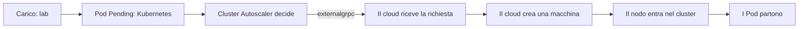

# Minikube Cloud Lab

Laboratorio didattico per osservare come Kubernetes chiede capacità a un cloud provider.
Il sistema separa tre oggetti:

| Oggetto | Cosa fa | Strumento |
| --- | --- | --- |
| Cloud simulato | Crea il cluster, possiede le macchine, registra le richieste | `cloud` |
| Kubernetes | Esegue i Pod e ospita Cluster Autoscaler | `kubectl` |
| Strumenti di laboratorio | Installano Autoscaler e generano pressione di risorse | `lab` oppure YAML |



L'MVP gestisce **un solo cluster alla volta**, con un tipo di macchina omogeneo.
Il control plane conta nel minimo e nel massimo ed è protetto dalla rimozione.

| Tipo | CPU | Memoria |
| --- | --- | --- |
| `lab-small` (default) | 2 | 4 GiB |
| `lab-medium` | 4 | 8 GiB |

Kubernetes è fissato a **v1.35.6**, Cluster Autoscaler a **v1.35.0**, la libreria
minikube a **v1.39.0**. I nodi espongono le label standard del tipo di istanza,
della regione `lab-region-1` e della zona `lab-region-1-a`.

## Percorso studente: VM Linux con Docker

Servono Docker Engine con Compose v2, accesso al socket Docker e `kubectl` v1.35
per osservare il cluster. Per il percorso predefinito predisporre almeno 6 CPU e
12 GiB di memoria disponibile. Le immagini supportano Linux amd64 e arm64;
la verifica completa automatizzata viene eseguita su amd64.

Il repository e le immagini GHCR sono privati: serve accesso al repository e un
login Docker a `ghcr.io` con credenziali autorizzate alla lettura dei package.
In alternativa, costruire le immagini dal checkout come descritto più avanti.

```sh
git clone git@github.com:miciav/minikube-cloud-lab.git ~/cloud-lab
cd ~/cloud-lab
mkdir -p "$HOME/.minikube-cloud-lab" "$HOME/.kube"
printf 'UID=%s\nGID=%s\nDOCKER_GID=%s\n' \
  "$(id -u)" "$(id -g)" "$(stat -c '%g' /var/run/docker.sock)" > .env
docker compose pull
docker compose up -d cloud

alias cloud='docker compose -f ~/cloud-lab/compose.yaml exec cloud cloud'
alias lab='docker compose -f ~/cloud-lab/compose.yaml run --rm lab'
cloud machine-types list
cloud clusters create demo --machine-type lab-small --min-nodes 1 --max-nodes 3
cloud clusters get-credentials demo
kubectl get nodes -L node.kubernetes.io/instance-type,topology.kubernetes.io/zone
```

Aspettare che `cloud machine-types list` risponda prima della creazione. Il primo
avvio scarica immagini e componenti Kubernetes e può richiedere alcuni minuti.
Il kubeconfig contiene i certificati incorporati, conserva gli altri contesti e
seleziona `demo` come contesto corrente. Viene pubblicato atomicamente con permessi
`0600`; se `KUBECONFIG` elenca più file, le voci unite vengono scritte nel file selezionato.

In un altro terminale osservare le richieste ricevute dal cloud:

```sh
cd ~/cloud-lab
docker compose logs -f cloud
```

Installare Autoscaler e creare carico:

```sh
lab install autoscaler
kubectl -n kube-system rollout status deployment/cluster-autoscaler --timeout=5m
lab load start
kubectl get pods -l app=lab-load -w
```

I quattro Pod richiedono ciascuno 600m CPU: una macchina `lab-small` non può
ospitarli tutti. Nei terminali di osservazione seguire gli anelli della catena:

```sh
kubectl get nodes -w
kubectl -n kube-system logs -f deployment/cluster-autoscaler
cloud machines list
cloud operations list
```

Quando ci sono due nodi Ready e i Pod sono in esecuzione, rimuovere il carico:

```sh
lab load stop
kubectl get nodes -w
cloud operations list
```

Autoscaler attende i ritardi di scale-down configurati nei manifest e riporta il
cluster a una macchina. Prima di cancellare il cluster, verificare con
`cloud operations list` che anche la rimozione della macchina sia terminata:
il nodo Kubernetes può scomparire prima che il cloud abbia finito il teardown.
Le operazioni riportano requester `student` oppure
`cluster-autoscaler`, stato, durata ed eventuale errore. `cloud` identifica le
osservazioni tecniche registrate durante la riconciliazione dopo un riavvio.

Per terminare il laboratorio:

```sh
lab uninstall autoscaler
cloud clusters delete demo
docker compose down
```

`lab` applica via API Kubernetes gli stessi file visibili in
[`lab/manifests`](lab/manifests) e stampa il comando `kubectl` equivalente.
Si possono applicare direttamente con `kubectl apply --server-side --field-manager=lab -f`.

## Comandi

| Comando | Effetto / opzioni |
| --- | --- |
| `cloud serve` | Avvia API e servizio externalgrpc; `--data-dir`, `--api` (loopback), `--grpc` |
| `cloud machine-types list` | Mostra il catalogo |
| `cloud clusters create NAME` | `--machine-type lab-small`, `--min-nodes 1`, `--max-nodes 3`, `--async` |
| `cloud clusters list` | Elenca il cluster gestito |
| `cloud clusters describe NAME` | Mostra forma, limiti e stato |
| `cloud clusters delete NAME` | Cancella cluster e macchine; `--async` |
| `cloud clusters get-credentials NAME` | Aggiorna `$KUBECONFIG` o `~/.kube/config` |
| `cloud machines list` | `--cluster NAME` per filtrare |
| `cloud operations list` | Registro, più recenti prima |
| `cloud operations describe ID` | Dettaglio dell'operazione |
| `lab install autoscaler` / `lab uninstall autoscaler` | Installa / rimuove Autoscaler |
| `lab load start` / `lab load stop` | Crea / elimina il carico; `start --replicas N` |

La CLI cloud usa `--api-url` oppure `CLOUD_API_URL` (default
`http://127.0.0.1:8080`). `lab` accetta `--kubeconfig` e `--context`.
I comandi di creazione e cancellazione attendono l'esito: con `--async` restituiscono
l'ID. Ctrl-C interrompe l'attesa del client; l'operazione continua nel servizio.

## Stato e reset

Compose monta `~/.minikube-cloud-lab` in `/data` e `~/.kube` in `/kube`.
`state.json` conserva cluster, macchine e operazioni; `minikube/` contiene lo stato
isolato del backend. Il servizio non usa il profilo minikube personale dell'utente.
Al riavvio marca le operazioni interrotte come ERROR e riconcilia le macchine.
Se Docker non è osservabile, conserva i riferimenti alle macchine e avvia l'API
con il cluster in ERROR per consentire il cleanup. Un'aggiunta fallita può aver già
creato una macchina: questa resta registrata; se l'osservazione fallisce, resta
prenotata la capacità fino alla riconciliazione o alla cancellazione del cluster.

`docker compose down` ferma il servizio e conserva dati e macchine. **Prima di
eliminare la directory di stato**, usare `cloud clusters delete NAME` e attenderne
l'esito: cancellare soltanto i file farebbe perdere il riferimento alle risorse Docker.
Poi, per azzerare anche il registro:

```sh
docker compose down
rm -rf "$HOME/.minikube-cloud-lab"
```

Il contesto in kubeconfig resta presente dopo la cancellazione del cluster;
gli altri contesti sono conservati. Non eliminare tutta `~/.kube` per questo reset.

Il cloud controlla il socket Docker della VM. L'API di gestione ascolta soltanto
su `127.0.0.1:8080`; externalgrpc su `0.0.0.0:9090` per essere raggiunto dai nodi
come `host.minikube.internal:9090`. L'MVP non ha autenticazione o TLS: usare una
VM di laboratorio fidata e limitare l'accesso alla porta 9090 alla rete dei nodi.

## Sviluppo

Servono Go 1.27.3, `uv` per pre-commit e Docker per le prove reali.

```sh
make build
make test
make verify
make integration
make images
```

`make verify` esegue lint, controllo moduli, analisi vulnerabilità, coverage ≥90%
e race detector. Il coverage include tutti i pacchetti scritti a mano e i main,
esclude l'adapter minikube verificato con integration e i bindings proto generati.
Il report completo `vuln-report.json` è ignorato da Git: il gate applica una triage
esatta per ID/modulo/versione a tre advisory non applicabili al nostro uso
(`GO-2023-1961`, `GO-2026-4887`, `GO-2026-4883`), documentata con fonti primarie in
[`tools/vulncheck`](tools/vulncheck). Qualsiasi altro finding raggiungibile blocca il gate.

`make integration` crea un cluster reale, controlla risorse, label, DNS e kubeconfig,
aggiunge e rimuove una macchina e cancella tutto, con il binario minikube assente
dal PATH. Richiede Docker attivo e risorse libere; timeout 30 minuti.

Per usare le immagini appena costruite sulla VM Linux, aggiungere a `.env`:

```dotenv
CLOUD_IMAGE=minikube-cloud-lab/cloud:dev
LAB_IMAGE=minikube-cloud-lab/lab:dev
```

La CI verifica Go, manifest, Compose e immagini su Ubuntu amd64, esegue Trivy
CRITICAL/HIGH con fix disponibili e pubblica immagini amd64/arm64 su GHCR.
Il workflow manuale `Student path` esegue il ciclo Compose completo 1→2→1.

### macOS con Docker Desktop

Usare i binari nativi per lo sviluppo; il percorso Compose con rete host è destinato
alle VM Linux. Attivare Docker Desktop e rendere disponibili almeno 6 CPU e 12 GiB.
Il backend usa il contesto Docker selezionato da Docker Desktop.

```sh
go build -o /tmp/cloud-lab-cloud ./cmd/cloud
go build -o /tmp/cloud-lab-lab ./cmd/lab
/tmp/cloud-lab-cloud serve
```

In un secondo terminale:

```sh
alias cloud=/tmp/cloud-lab-cloud
alias lab=/tmp/cloud-lab-lab
cloud clusters create demo
cloud clusters get-credentials demo
lab install autoscaler
lab load start
```

Poi seguire gli stessi comandi di osservazione e pulizia del percorso studente.
Non avviare due servizi sulla stessa directory di stato.

### Backend

Il cloud chiama direttamente la libreria Go minikube: non richiede i binari
`minikube` o `kubectl`. La libreria upstream avvia internamente Docker CLI e altri
strumenti; l'immagine cloud contiene Docker CLI e curl. Il codice Go del progetto
non avvia processi esterni; i test possono usarli per misurare il sistema reale.
Su Linux il client SDK Docker applica anche le quote CPU/RAM, perché il driver
minikube fissato può ignorare la quota CPU su cgroup v2. Usa `DOCKER_HOST` oppure
il socket locale; contesti Docker remoti senza `DOCKER_HOST` non sono supportati.

I container nodo condividono il kernel dell'host: Kubernetes può mostrare la
capacità grezza dell'host. Le quote Docker limitano le risorse reali e la riserva
kubelet rende **Allocatable** uguale al tipo di macchina, coerente con il template
fornito ad Autoscaler. Dopo cambiamenti alle risorse dell'host ricreare il cluster.
