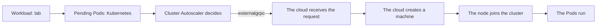

# Development and verification

## Build and test

You need Go 1.27.4, Bash and zsh for the configuration tests, `uv` for pre-commit,
and Docker for real infrastructure tests. Frontend development/tests also require
Node.js 26.13.1 and `npm --prefix web ci`; students need neither Node nor Go.

```sh
make build
make test
make verify
make integration
make images
make storage-integration
make portal-test
npx --prefix web playwright install chromium
npm --prefix web run test:e2e
make portal-smoke
```

`make verify` runs lint, module checks, vulnerability analysis, the 90% coverage
gate, and the race detector. Coverage includes all handwritten packages and the
command entry points. It excludes the minikube and NFS runtime adapters covered by integration
tests and the generated protocol bindings. `make storage-integration` runs real
Linux filesystem/mount tests inside an isolated Docker container.

The complete `vuln-report.json` is ignored by Git. The gate applies exact
ID/module/version triage to three advisories that do not apply to our usage
(`GO-2023-1961`, `GO-2026-4887`, `GO-2026-4883`), documented with primary sources in
[`tools/vulncheck`](../tools/vulncheck). Any other reachable finding fails the gate.

`make integration` creates a real cluster, checks resources, labels, DNS, and
kubeconfig, adds and removes a machine, and deletes everything with the minikube
executable absent from PATH. It requires a running Docker daemon and available
resources; the timeout is 30 minutes.

To use locally built images on Linux or macOS, add these entries to `.env`:

```dotenv
CLOUD_IMAGE=minikube-cloud-lab/cloud:dev
LAB_IMAGE=minikube-cloud-lab/lab:dev
NFS_IMAGE=minikube-cloud-lab/nfs:dev
PORTAL_IMAGE=minikube-cloud-lab/portal:dev
UBUNTU_IMAGE=minikube-cloud-lab/instance-ubuntu:dev
DEBIAN_IMAGE=minikube-cloud-lab/instance-debian:dev
```

CI checks Go, TypeScript, UI/browser tests, manifests, a live portal-to-cloud image
smoke test, Compose, and images on Ubuntu amd64. It runs Trivy against
fixable CRITICAL/HIGH findings, and publishes amd64/arm64 images to GHCR.
The opt-in browser test `PORTAL_REAL_URL=http://localhost:3000 npm --prefix web run test:e2e -- real.spec.ts`
creates and deletes a real cluster and volume: run it only against a disposable
cloud with dedicated state/storage, never a student cloud containing work.
The [Student path workflow](../.github/workflows/student-path.yml) runs on relevant pull requests or by manual dispatch. It runs the complete Compose
1→2→1 cycle.

## Cluster model



The MVP manages **one cluster at a time**, with a single machine type throughout.
The control plane counts toward the minimum and maximum size and is protected
from removal.

| Type | CPUs | Memory |
| --- | --- | --- |
| `lab-small` (default) | 2 | 2 GiB |
| `lab-medium` | 4 | 8 GiB |

Kubernetes is pinned to **v1.35.6**, Cluster Autoscaler to **v1.35.0**, and the
minikube library to **v1.39.0**. Nodes expose the standard instance-type label,
region `lab-region-1`, and zone `lab-region-1-a`.

New clusters use the internal DNS domain `cloudlab.internal`; service names follow
`<service>.<namespace>.svc.cloudlab.internal`. Existing clusters retain their
original DNS domain. Using the new domain requires creating a new cluster with
the updated cloud software; the lecture02 MongoDB examples assume this domain.

Existing clusters keep their original machine resources. To adopt the smaller
`lab-small` shape, delete the old cluster through `cloud`, pull the updated
images, and create a new cluster. The configuration helper does not resize or
delete machines.

## Backend

The cloud calls the minikube Go library directly; it does not require the
`minikube` or `kubectl` executables. The upstream library internally starts
Docker CLI and other tools; the cloud image includes Docker CLI and curl.
The project's Go code does not start external processes; tests may do so to
measure the real system.

Bootstrap composes driver, libmachine, runtime, CNI, and kubeadm Go primitives
that return errors. It avoids the CLI helpers `node.Start`, `node.Add`,
`node.Delete`, and `machine.StartHost`, which can call `os.Exit`. Draining uses
the Kubernetes Go helper and API client; it does not execute kubectl.
Only the Docker driver and automatically assigned node addresses are supported.

On Linux, the Docker SDK client also applies CPU/memory limits because the pinned
minikube driver may skip CPU limits on cgroup v2. It uses `DOCKER_HOST` or the
local socket; remote Docker contexts without `DOCKER_HOST` are not supported.

Node containers share the host kernel, so Kubernetes may report the host's raw
capacity. Docker quotas enforce actual limits, and kubelet reservation makes
**Allocatable** match the machine type and the template supplied to Autoscaler.
Recreate the cluster after changing host resources.

## Live acceptance checks

Use a disposable lab for a complete run. See [course verification](course-verification.md) for runtime selection, prerequisites, expected results and cleanup.

For the lecture03 deck (HPA, VPA, Cluster Autoscaler, KEDA, CRD and MySQL Operator),
use the separate [lecture03 runner](../kubernetes/lecture03/README.md#run-the-deck-automatically):
`python3 scripts/verify-lecture03.py --recreate-empty-cluster`.
It requires a running platform and an empty, disposable `lecture03` cluster
(or no cluster). Unlike the general acceptance suite, it recreates that dedicated
cluster between machine sizes and deletes it after successful cleanup, leaving cloud services running.


## Course tooling image

The `lab` target supplies kubectl, OpenTofu, the local provider, ansible-core and OpenSSH. CI publishes the same amd64/arm64 lab image used by the shell wrappers. The provider lives in `tools/tofu-provider`, a separate Go module using the existing cloud API client. The Docker build places the Linux binary for the target architecture in OpenTofu's filesystem mirror. Rebuild the course image when changing the provider, and keep the source address and version aligned with the capstone handout. Run `go -C tools/tofu-provider test -race ./...` for provider tests and `bash tests/capstone.sh` for the complete disposable deployment.

## Course monitoring

A dedicated Prometheus instance shares the cloud network namespace and listens on loopback port 9092. Its TSDB volume is separate from instance autoscaling. It scrapes three loopback-only paths under `/internal/metrics/` every 15 seconds. The existing portal proxies only `/v1/`. The history API translates allowlisted metrics and windows to Prometheus range vectors, preserving original timestamps and gaps.

For Garage and ElasticMQ the cloud service selects the running container by exact Compose project and service labels using its existing runtime client. It issues fixed read-only requests inside the service network namespace. Garage 2.1 returns `objects` and `bytes` through `json-api GetBucketInfo`. ElasticMQ 1.6 returns the three approximate message counts through `GetQueueAttributes`. Only aggregate values leave the collector. No monitoring credentials or additional service bridges are required. A source with over 128 buckets or queues exceeds the lab's per-scrape budget.

The ARM64 rehearsal used Docker 29.9.3 and rootless Podman 5.7.0 with podman-compose 1.5.0. The ten capstone uploads added 130 logical bytes. Podman also reported nonzero per-container CPU and memory for both standalone instances and autoscaling members under cgroup v2. Standalone VM usage and PostgreSQL counters are reserved for a later portal release.
